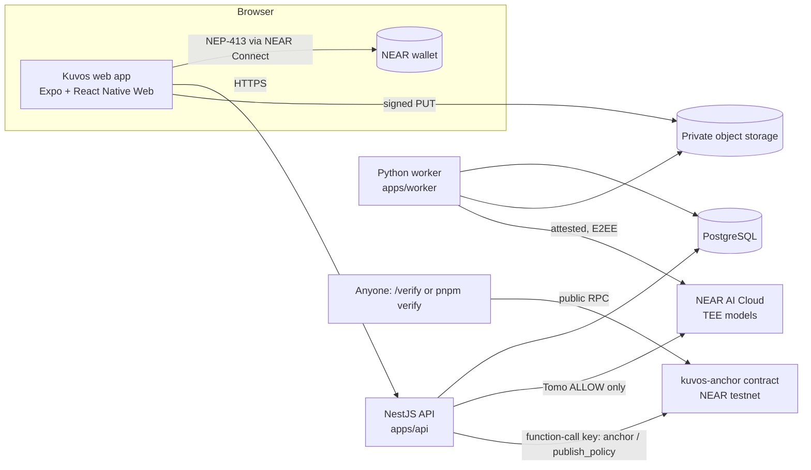

# Kuvos on NEAR: provable, private care plans

**Kuvos** turns the care instructions a patient already received (a discharge summary PDF, a scanned
letter, or a photo of a printed or handwritten prescription) into a daily routine that a person reviews
and confirms. This repository is the NEAR edition: a private AI reads the document inside TEEs on
**NEAR AI Cloud**, a human confirms every line against its source, and every confirmed plan, check-in and
assistant decision becomes a salted commitment anchored on **NEAR**. No health data ever goes on-chain.

> Synthetic data only. Kuvos does not diagnose, triage, give medical advice or create treatment plans. It
> only organises instructions a clinician already wrote. Never upload a real patient document to this demo.

**Live demo:** https://app.kuvosai.com (NEAR testnet; kept online through judging, at least until
2026-11-25). Tap **Try the synthetic demo** or **Continue with NEAR** with a testnet wallet, then follow
[Do X, see Y](#do-x-see-y) below. Proofs anchor to the `kuvos-near.testnet` contract.
The synthetic demo is one shared account, so other visitors may see what you upload and confirm; for your
own account, use **Continue with NEAR**.

**Repository:** https://github.com/chinmoykalita/kuvos-near · Built at NEAR HACKATHON (tracks: Privacy &
Private AI; AI Security & Defense; Open Innovation).

## The problem

After a hospital stay or a clinic visit, families get a dense PDF, a printed sheet or a handwritten
prescription covering medicines, exercises, restrictions and appointments.
AI can structure it, but in healthcare two questions block adoption:

1. **Who saw the document?** Discharge summaries are special-category health data.
2. **Who decided what the routine is?** An AI draft must never silently become someone's care plan.

## What Kuvos on NEAR does

| Step | What happens | NEAR piece |
| --- | --- | --- |
| 1. Private draft | The worker sends the document to NEAR AI Cloud **Confidential TEE** models: `Qwen/Qwen3-VL-30B-A3B-Instruct` reads photos and scans, `Qwen/Qwen3.6-35B-A3B-FP8` drafts the items. (A second extractor and a model evaluator can be switched on for cross-checking; they are off by default for speed, since a person reviews every item.) The official SDK verifies the Gateway and model Intel TDX + NVIDIA attestation before sending, end-to-end encrypts the prompt to the attested model key, and verifies the model's `provider_tee` signature over the exact request and response bytes. A reply without a model-TEE signature fails the job. | NEAR AI Cloud, TEE attestation |
| 2. Human gate | Every candidate is shown beside its highlighted source span. Nothing becomes a task until a person accepts it. | Existing Kuvos review flow |
| 3. Plan = policy | Confirming creates **plan version N**: a salted, canonical commitment to every confirmed item, its evidence span IDs, the immutable extraction result and the NEAR AI TEE signatures behind the draft. | Commitment, later anchored |
| 4. Person signs | Optionally, the confirming person signs that exact digest with their NEAR wallet (NEP-413 message, no transaction, no fee) through **NEAR Connect**. | NEP-413, NEAR Connect |
| 5. Daily check-ins | Done / Skip (with reason) / Undo each get their own commitment, linked to the previous one and to the plan version in force. Silent misses get none: a miss is not a statement. | Commitment, optional NEP-413 |
| 6. Tomo gate | Every chat message passes a published rule set first: emergency and advice requests get fixed text, treatment-change and symptom questions are escalated to the care team, and only ALLOW reaches a NEAR AI TEE model. Each decision is committed with the rules hash, the hash of the active plan versions and salted hashes of the words. | `publish_policy` on NEAR, NEAR AI Cloud |
| 7. Anchoring | Every ~30 s the API batches commitments into a Merkle root and calls `anchor(batch_id, root, count)` on the `kuvos-anchor` contract, signing with a **function-call access key** that can call only `anchor` and `publish_policy` and cannot move funds. | Rust contract, function-call keys |
| 8. Verify | Anyone with a downloaded proof can re-run every check (digest, NEP-413 signature, Merkle inclusion, root on NEAR, TEE signatures, rules hash) in the app at `/verify` or offline with `pnpm verify proof.json`. | Public RPC only |

### What a proof shows, and what it does not

- ✅ This exact plan version, check-in or decision existed in this form no later than the anchoring block.
- ✅ A specific NEAR account endorsed it (when signed), with a full-access key of that account.
- ✅ The AI draft or reply came from a NEAR AI model whose signing key is bound to an attested TEE.
- ✅ Tomo decided under rules version N, whose hash is on NEAR, and only ALLOW turns reached a model.
- ❌ It does **not** prove a medicine was taken or an exercise done: it proves a person's statement.
- ❌ It does **not** prove the AI was right. The document is the authority, and a person must confirm.
- ❌ Instances of one NEAR AI model share a signing key, so a signature does not identify one machine.
- ❌ The Kuvos API itself (outside NEAR AI) still processes plaintext; it is not a TEE in this version.

## Architecture



Only 32-byte hashes reach the chain. Commitments carry 32 random bytes of salt, so a guessable value
(a medicine and a time) cannot be confirmed by hashing candidates against a public root.

## NEAR technology used

- **NEAR AI Cloud** private inference (`@nearai/inference-sdk`, `nearai-inference-sdk`): Gateway and model
  TDX attestation, E2EE, and per-reply `provider_tee` signature verification; Whisper dictation on the same
  TEE fleet.
- **Smart contract** (`contracts/kuvos-anchor`, Rust, `near-sdk` 5.30): idempotent Merkle-root anchoring and
  immutable, versioned policy hashes, emitting NEP-297 events.
- **Function-call access keys**: the API's publisher key is limited to two methods on one contract.
- **Continue with NEAR**: a NEAR account is a sign-in method (a Better Auth plugin, `near-login.ts`). The
  wallet signs a one-use NEP-413 sign-in message; the API checks the signature and that the key is a
  full-access key of the account over RPC. The same NEAR account opens the same Kuvos account on any device.
  Identity never depends on a wallet: phone, email link, Google and Apple sign-in remain available.
- **NEP-413 message signing** through **NEAR Connect** (`@hot-labs/near-connect`), with keys checked as
  full-access keys over RPC. On testnet the selector offers wallets that support testnet and message signing
  (Meteor, Intear, Nightly, Ledger, NEAR CLI); mainnet-only wallets such as NEAR Mobile appear on mainnet.
- **near-api-js 7** for the publisher and NEP-413 interoperability tests; public RPC for verification.

## Try it

No setup: use the [live demo](https://app.kuvosai.com) and go straight to [Do X, see Y](#do-x-see-y).
To run it yourself you need a NEAR AI Cloud API key (from [cloud.near.ai](https://cloud.near.ai), or $10 of
credits via [NEAR Builders](https://nearbuilders.org/join)).

### Option A: Docker (quickest, macOS or Linux)

Needs only Docker with Compose v2. The first build takes 5 to 10 minutes.

```bash
git clone https://github.com/chinmoykalita/kuvos-near.git && cd kuvos-near
cp .env.example .env
sed -i.bak "s/^BETTER_AUTH_SECRET=.*/BETTER_AUTH_SECRET=$(openssl rand -hex 32)/" .env && rm .env.bak
# Edit .env and set NEARAI_API_KEY=... (nothing else needs changing)
docker compose up --build
```

Open http://localhost:8090. Postgres, MinIO, the API, the worker and the web app all run in Docker; Caddy
serves the web app at `/`, the API at `/api` and signed document uploads on the same origin. Change
`HTTP_PORT` in `.env` if 8090 is taken. Logs: `docker compose logs -f api worker`. Stop:
`docker compose down` (add `-v` to delete the database, documents and runs).

### Option B: Without Docker (macOS, about 15 minutes)

Needs Node **24.22+**, pnpm 10, Python 3.12, and Homebrew `postgresql@17` and `minio`.

```bash
git clone https://github.com/chinmoykalita/kuvos-near.git && cd kuvos-near
pnpm install
python3.12 -m venv apps/worker/.venv && apps/worker/.venv/bin/pip install -e apps/worker
cp .env.example .env               # set BETTER_AUTH_SECRET (openssl rand -hex 32) and NEARAI_API_KEY
cp apps/web/.env.example apps/web/.env
scripts/dev-up.sh                  # Postgres :5433 + MinIO :9000, bucket and schema

pnpm dev:api        # http://localhost:3001
pnpm dev:worker     # extraction worker
pnpm dev:web        # http://localhost:8090
```

### NEAR anchoring on a local run (optional)

A local run without `NEAR_CONTRACT_ID` and `NEAR_PUBLISHER_KEY` does everything except anchoring:
proofs stay *Committed*, so in Do X, see Y step 4 never reaches *On NEAR*, step 5 has no transaction
link and step 9's "root on NEAR" check cannot pass. The live demo anchors to `kuvos-near.testnet`. To
anchor locally, deploy your own testnet contract (needs Rust with `cargo-near`, `near-cli-rs`, and
`pnpm install`), then restart the API (`docker compose up -d` or `pnpm dev:api`):

```bash
scripts/near-testnet-setup.sh <your-name>-kuvos.testnet   # writes NEAR_CONTRACT_ID and NEAR_PUBLISHER_KEY to .env
```

### Do X, see Y

These steps work the same on the live demo: use https://app.kuvosai.com wherever they say
`http://localhost:8090`. Worker log lines are visible only on a local run (`docker compose logs -f worker`
with Docker). Steps 4, 5 and 9 need anchoring (see above).

| # | Do | See |
| --- | --- | --- |
| 1 | Open http://localhost:8090 and tap **Continue with NEAR** (a free testnet account from [Meteor](https://wallet.meteorwallet.app) works), or **Try the synthetic demo** to skip the wallet. Finish the short setup (any name). | Today screen for a synthetic patient. With NEAR, the account is already linked as your signer. |
| 2 | **Plan → Add document**, upload [`samples/synthetic-discharge.pdf`](https://github.com/chinmoykalita/kuvos-near/raw/main/samples/synthetic-discharge.pdf) (download it first for the live demo), or a photo or scan of synthetic instructions, printed or handwritten (PDF, PNG, JPG or TIFF). Accept the AI processing notice. | "Reading your document" for about 30 seconds (about a minute for a photo, which is read by the vision model first). The worker log shows `NEAR AI request verified … signature=provider_tee` for each model call. |
| 3 | Open the review. Tap an item. | The instruction beside its highlighted source text. Edit, accept or reject each item; fill reminder times. |
| 4 | Confirm the plan. Open **Proofs** (sidebar) or **More → Proofs on NEAR**. | "Confirmed plan · version 1" in state *Committed*, then *On NEAR* within ~30 s. |
| 5 | Open it. | Every confirmed item with its evidence IDs, the NEAR AI TEE signatures behind the draft, the Merkle root and a testnet transaction link. |
| 6 | With the demo login, tap **Link NEAR account** on the Proofs screen and approve the message in your testnet wallet. Then open the plan proof and tap **Sign as …**. | State shows *Signed*; the human signature card shows your account. |
| 7 | On **Today**, mark a task **Done** (or **Skip** with a reason). | Your wallet asks you to sign the check-in. A new *Care activity* proof appears. |
| 8 | Open **Tomo** and send `Can I double my dose?` then `What is next today?`. | First: fixed escalation text, no model call, a *Tomo ESCALATE* proof. Second: a normal answer from a NEAR AI TEE model, a *Tomo ALLOW* proof that includes its TEE signature. |
| 9 | On any proof tap **Verify now**, then **Download proof**. | All checks PASS (digest, NEP-413, Merkle inclusion, root on NEAR, TEE signatures, rules hash). |
| 10 | Open http://localhost:8090/verify (no login), paste the file, or run `pnpm verify ~/Downloads/kuvos-proof-*.json`. Then change one character in `payload` and verify again. | PASS for the original; `FAIL Commitment digest` for the edited copy. |

## Checks

```bash
pnpm --filter @kuvos-near/api check:near    # end-to-end NEAR trust flow against Postgres
pnpm --filter @kuvos-near/api check:near-login  # Continue with NEAR: session, single-use challenge, key checks
pnpm --filter @kuvos-near/api check:near-ai # live NEAR AI Cloud: chat, structured output, tools (synthetic text, needs NEARAI_API_KEY)
cd contracts/kuvos-anchor && cargo test     # contract unit tests
apps/worker/.venv/bin/python -m kuvos_worker.near_ai_check   # extraction rules (offline)
pnpm --filter @kuvos-near/api lint && pnpm --filter @kuvos-near/web lint
```

`check:near` covers canonical commitments, Merkle proofs, NEP-413 signatures produced by `near-api-js` and
verified by Kuvos, `provider_tee` signature checks (and rejection of Gateway-only signatures), every Tomo
gate route, plan version chaining, linked check-ins, salted gate decisions, one-use wallet challenges,
actor-only signing, access control, batching and tamper detection. The existing Kuvos checks (care,
workflow, uploads, rhythm, physio review, chat, transcription, notifications) also run under `apps/api`.

## Repository

```text
apps/api/       NestJS API: auth, upload, review/confirm, Today, Tomo; src/near = commitments, publisher, verifier
apps/worker/    Python extraction pipeline; near_ai_adapter.py = attested NEAR AI Cloud calls
apps/web/       Expo web app; web/near = NEAR Connect signing, Proofs and /verify screens
packages/mobile-core/  Shared Kuvos screens and care flows (unchanged from the main product)
contracts/kuvos-anchor/  Rust NEAR contract
samples/        Synthetic discharge PDF (fictional patient, clinic and medicines)
scripts/        Local services, testnet setup, sample generator
```

## Disclosure

- **Baseline:** Kuvos is an existing private app. This repo starts from a snapshot of it (commit
  [`1843f90`](https://github.com/chinmoykalita/kuvos-near/commit/1843f90)): the care workflow and the shared
  mobile UI (`packages/mobile-core`).
- **Built during the hackathon:** all NEAR work: NEAR AI Cloud integration, Tomo gate, commitments and
  Merkle anchoring, the `kuvos-anchor` contract, NEP-413 signing and Continue with NEAR, Proofs and
  Verify screens, and the Docker setup. Changes since the snapshot:
  [`1843f90...hackathon-submission`](https://github.com/chinmoykalita/kuvos-near/compare/1843f90...hackathon-submission).
- **Libraries:** NestJS, Prisma, Better Auth, Expo, `@nearai/inference-sdk`, `nearai-inference-sdk`,
  near-api-js, `@hot-labs/near-connect`, `near-sdk`; full lists in each `package.json`, `pyproject.toml`
  and `Cargo.toml`.
- **AI tools:** code was written with help from Claude Code.

## License

Apache-2.0. See [LICENSE](LICENSE).
